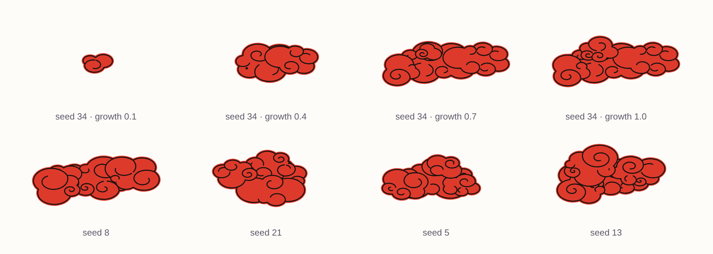

# curlykumo

Procedural clouds in the style of the kumo on hanafuda cards. Each cloud is generated from a seed, and it can grow from nothing to its full shape.



- One file, `curlykumo.js`. No dependencies and no build step.
- An HTML tag, `<curly-kumo>`, for placing and animating a cloud with one line.
- A generator function that returns SVG path data only, so you can apply your own stroke and fill rules.
- The same seed and parameters always give the same cloud.
- Every numeric parameter can be animated. A small change in a value gives a small change in the shape.

## Quick start

```html
<script src="curlykumo.js"></script>

<curly-kumo seed="34" enter="grow-in" leave="grow-out"></curly-kumo>
```

This cloud grows in when it scrolls into view and grows out when it scrolls out of view. The tag reserves the space of the fully grown cloud, so the page layout does not shift.

## Driving growth

On the tag, growth runs from 0 to 100.

| Driver | How |
|---|---|
| Timed | `grow="in"` or `grow="out"`; from JavaScript, `cloud.growIn()`, `cloud.growOut()`, `cloud.growTo(60)` |
| Fed from JavaScript | `cloud.growth = 37` |
| Scroll trigger | `enter="grow-in"` and `leave="grow-out"` |
| Scroll-linked | `scroll-link` |

Every driver sets a target. The cloud moves toward the target from the value it currently shows, so reversing direction does not cause a jump.

Feeding a progress value:

```html
<curly-kumo id="cloud" seed="21" growth="0"></curly-kumo>
```

```js
const cloud = document.getElementById('cloud');

collector.onProgress = (fraction) => { cloud.growth = fraction * 100; };

cloud.addEventListener('curlykumo-growend', (e) => {
  if (e.detail.growth === 100) onCloudFull();
});
```

Idle motion on a finished cloud:

```html
<curly-kumo seed="34" sway="0.6"></curly-kumo>
```

## Using the generator directly

```js
const frame = CurlyKumo.generate({ seed: 34, growth: 0.6 });   // growth: 0 to 1
```

```js
frame.masses      // back to front; each has `outline` (one closed path) and `curls` (open paths)
frame.silhouette  // every mass outline in one path string
frame.bounds      // { x, y, width, height }
```

Masses overlap, so draw them in array order: fill the outline, stroke the outline, then stroke the curls. `CurlyKumo.toSVG(frame, style)` and `CurlyKumo.draw(ctx, frame, style)` do this for you:

```js
svg.innerHTML = CurlyKumo.toSVG(frame, { fill: '#dd3a2c', stroke: '#1a1210', strokeWidth: 2.4, margin: 3.2 });
```

Call `generate` again for every animation frame. Do not interpolate between two path strings, because the number of path commands changes as the cloud grows.

In Node:

```js
const CurlyKumo = require('./curlykumo.js');
```

## Parameters

| Name | Range | Default | Effect |
|---|---|---|---|
| `seed` | integer | 34 | Selects which cloud. Do not animate. |
| `growth` | 0 to 1 | 1 | 0 is nothing, 1 is the full cloud. |
| `lobe` | 8 to 48 | 26 | Mean lobe radius. Scales the whole cloud. |
| `sizeVar` | 0 to 0.8 | 0.6 | Variation of lobe size. |
| `overlap` | 0.15 to 0.4 | 0.28 | Overlap of neighbouring lobes. |
| `squash` | 0.45 to 1 | 0.7 | Vertical squash. 1 gives round lobes. |
| `thickness` | 0.9 to 1.8 | 1.15 | Half-thickness of a mass, in lobe radii. |
| `length` | 4 to 16 | 9 | Lobe count of the first mass at full growth. |
| `masses` | 1 to 5 | 4 | Number of masses at full growth. |
| `spread` | 0 to 1.2 | 0.5 | How far a new mass sits outside the one it emerges from. |
| `irregularity` | 0 to 0.3 | 0.12 | Unevenness of each mass body. |
| `curl` | 0 to 1 | 1 | Share of eligible lobes that carry a curl. |
| `turns` | 0.3 to 1.8 | 1 | Mean curl length, in turns. |
| `tight` | 0.1 to 0.4 | 0.2 | Curl decay. Higher gives a smaller spiral. |
| `curlVar` | 0 to 1 | 0.6 | Variation between curls. |
| `sway` | 0 to 1 | 0 | Amount of idle variation. |
| `phase` | any number | 0 | Position in the idle variation. |

On the tag, write the same names with hyphens, for example `size-var` and `curl-var`.

The full reference is in [docs/agent-guide.md](docs/agent-guide.md): every tag attribute, method and event, the required render order, and the tested behaviour. It is written so that a coding agent can use the library from that file alone.

## Demo and examples

| File | Shows |
|---|---|
| `demo/index.html` | Playground with a slider for every parameter |
| `examples/timed.html` | Grow in and grow out from buttons |
| `examples/progress.html` | Growth fed by a number collected from pointer movement |
| `examples/scroll.html` | Scroll trigger and scroll-linked growth |

Open any of them in a browser from a local copy of the repository. They load `../curlykumo.js`, so keep the folder structure.

To publish the demo with GitHub Pages, set Pages to deploy from the root of the main branch. The playground is then at `/demo/`.

## Tests

The generator tests need only Node.

```sh
npm test              # validity and arc accuracy, about 30 seconds
npm run test:smooth   # no sudden jumps while a parameter moves, about 2 minutes
```

The tag tests run in a headless browser and need Playwright.

```sh
npm install
npx playwright install chromium
npm run test:browser
```

`npm run test:all` runs everything at full size and takes several minutes.

| Check | Result at version 2.3.0 |
|---|---|
| Invalid numbers in path data | 0 in 33,600 frames, including the ends of the parameter ranges |
| Outlines not closed | 0 in the same 33,600 frames |
| Curls crossing inside a mass | 0 of 3,400 masses |
| Outline arcs drawn off the lobe edge | 0 of 11,270,877 arcs across three parameter sweeps |
| Sudden jumps while one parameter moves | 0 in 384,000 steps across 8 parameters |
| Tag behaviour in headless Chromium | 10 of 10 tests passed |

## Browser support

The tag uses custom elements, shadow DOM and `IntersectionObserver`. It has been tested in Chromium only. Firefox and Safari are untested.

If a visitor's system asks for reduced motion, timed changes complete at once, `sway` is off, and clouds with `enter="grow-in"` or `scroll-link` are shown fully grown.

## Known limits

- A curl is hidden where it passes under a younger lobe of its own mass. This prevents crossings, and it can leave a curl with a gap.
- A mass starts smaller than the line is wide, so it first appears as a dot of the line colour.
- Line width is in geometry units and the tag scales its drawing to its width. Add `non-scaling-stroke` to keep the width constant in screen pixels.

## Licence

MIT. See [LICENSE](LICENSE).

The cloud style follows the kumo printed on hanafuda playing cards. This repository contains no card artwork.
